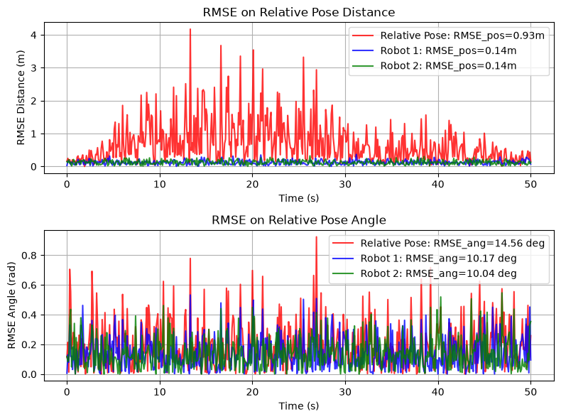
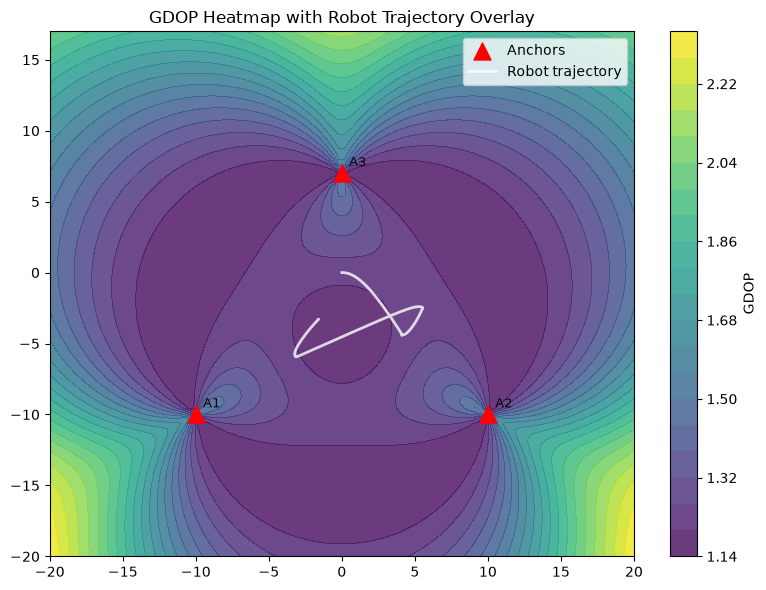
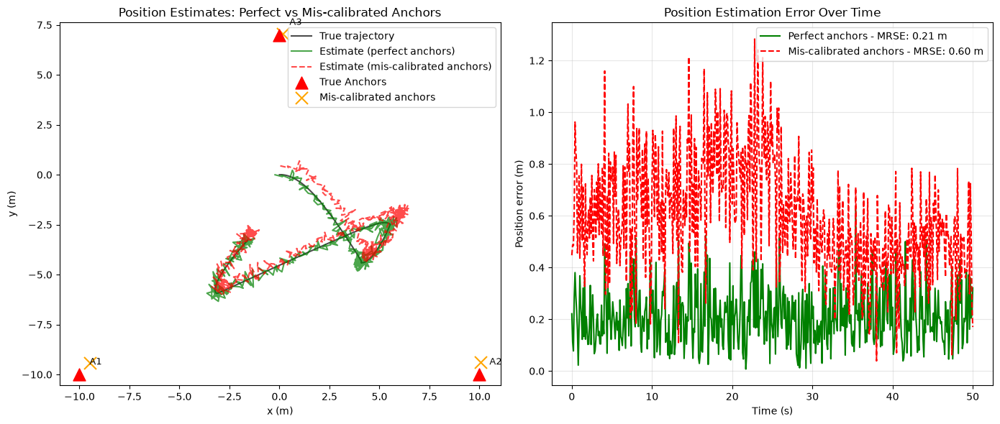
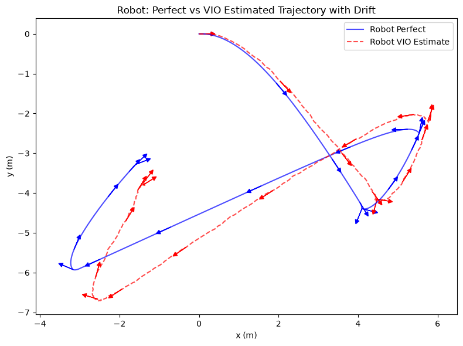
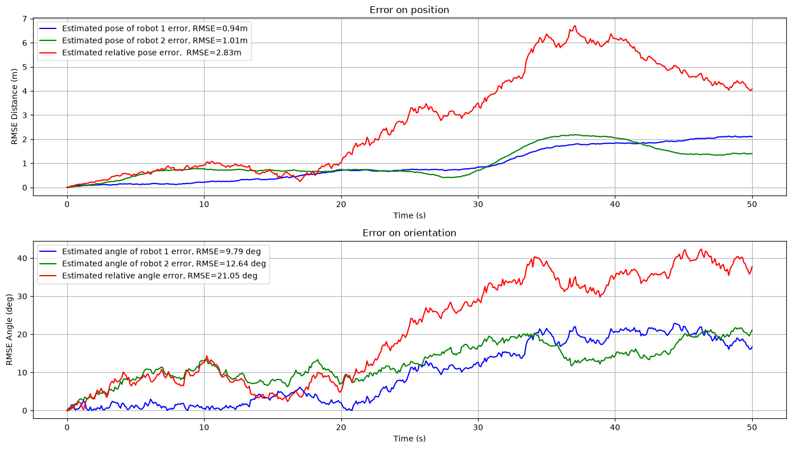
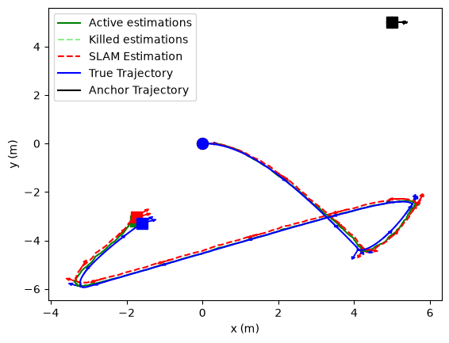
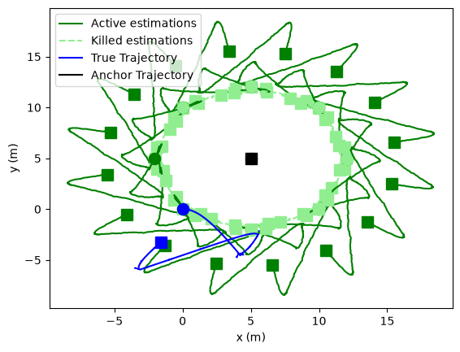
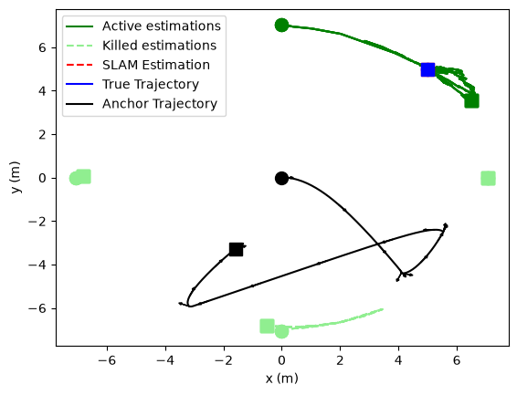

# Relative-localisation-tutorial

An interactive, open-source Python tutorial on **relative localisation for multi-robot systems**.
In four Jupyter notebooks you simulate 2D robot trajectories and noisy sensors, and see how
different ways of localising robots affect the estimate of where one robot is *relative to another*:
global positioning, UWB anchors, drifting SLAM/VIO odometry, and finally a single UWB beacon fused
with odometry in an Unscented Particle Filter (UPF).

The tutorial was developed at VUB within the euROBIN project and given as a hands-on session to
eight participants on 28 August 2026. The material may still change.

## Tutorial overview

Each part is a notebook in `notebooks/`. Notebook cells only set parameters and call one function;
the simulation and plotting code lives in `src/`. Change the parameters, re-run the cell, and compare.

### Part 1 — Global localisation

Each robot gets a global pose measurement with noise σ_x (position) and σ_θ (heading). Low
values correspond to motion-capture accuracy, higher values to UWB-level accuracy. The notebook
shows how this noise affects the global pose of one robot, and then the relative pose between two
robots, where the errors of both robots add up.
Code: `src/part1_functions.py`.

**Parameters to play with:** `sigma_x` (m), `sigma_theta` (deg), trajectory seeds.



*Error on the relative pose between two robots over time, compared with the error of each robot's
own global pose. The relative pose error is larger than either robot's own error: global errors
compound in the relative estimate.*

### Part 2 — UWB anchors

The robot's position is estimated by trilateration from noisy ranges to fixed UWB anchors. The
notebook shows the effect of range noise, uses a Geometric Dilution of Precision (GDOP) heatmap to
show how anchor geometry amplifies that noise, and finally adds anchor mis-calibration: errors in
the assumed anchor positions.
Code: `src/part2_functions.py`, `src/uwb.py`.

**Parameters to play with:** `sigma_uwb` (range noise, m), `anchor_positions`, `sigma_uwb_anchor`
(anchor mis-calibration, m).



*GDOP heatmap for three anchors, with the anchors and the robot trajectory (white) overlaid. Low
GDOP means the anchor geometry amplifies range noise only a little.*



*Left: position estimates with perfectly known vs mis-calibrated anchor positions. Right: position
error over time. Mis-calibrated anchors give a clearly larger error than range noise alone.*

### Part 3 — SLAM/VIO drift

Instead of absolute measurements, each robot integrates noisy odometry (velocity noise σ_v and
angular-rate noise σ_ω), as a SLAM or visual-inertial odometry (VIO) system would. Small errors add
up into unbounded drift. With two robots, the drift of both robots compounds in their relative pose.
Code: `src/part3_functions.py`, `src/vio_sensor.py`.

**Parameters to play with:** `VIOConfig(sig_v=..., sig_w=...)`, trajectory seeds.



*True trajectory (blue) against the VIO estimate (red dashed). The estimate drifts further away
over time.*



*Position and orientation error over time for two robots using VIO and for their relative pose.
The relative pose error is larger than either robot's own error: the drift of both robots compounds.*

### Part 4 — One UWB beacon

Odometry is fused with ranges to a single UWB anchor in an Unscented Particle Filter (UPF), started
from a grid of initial hypotheses. The notebook covers three cases: (a) tracking
a robot from a known start pose, (b) estimating the robot's location from an unknown start pose,
and (c) the inverse problem, estimating the anchor's position from the robot's trajectory. Together
they show the observability limits of ranging to one beacon.
Code: `src/upf_2d.py`, `src/part4_functions.py`.

**Parameters to play with:** `anchor_pos`, `sigma_v`, `sigma_w`, `sigma_uwb`, and the number of
initial hypotheses `n_azimuth` × `n_heading`.



*(a) Known start pose, one UWB anchor at (5, 5): the true trajectory (blue) and the UPF estimate
(red dashed) follow each other closely.*



*(b) Unknown start pose with 8 × 8 initial hypotheses around the anchor (black). The surviving
hypotheses (green) form rotationally symmetric "flower" trajectories, and killed hypotheses are
shown in light green: ranges to a single anchor cannot resolve the rotation around it.*



*(c) The inverse problem with 4 × 4 hypotheses: estimating the anchor's position from the robot's
trajectory (black). The active hypothesis converges near the true anchor (blue square); the
others are killed (light green).*

## Requirements

- Linux (the setup uses `apt` packages and a bash install script)
- Python 3.11
- System packages:
  ```bash
  sudo apt-get install -y libeigen3-dev python3.11-dev build-essential cmake ninja-build
  ```
- `pybind11` for Python 3.11 (needed to build `manifpy`):
  ```bash
  python3.11 -m pip install "pybind11[global]"
  ```

## Installation

```bash
git clone --recurse-submodules https://github.com/y2d2/Relative-localisation-tutorial.git
cd Relative-localisation-tutorial
git submodule update --init --recursive   # if you cloned without --recurse-submodules
./install.sh
source .venv/bin/activate
```

`install.sh` does the following:

1. Creates a `.venv` virtual environment with Python 3.11 (or reuses an existing one).
2. Builds and installs `manifpy` from the `libs/manif` submodule.
3. Installs `arp_utility_code` from `libs/arp_utility_code-0.1.0.tar.gz`.
4. Converts `libs/UPF_RPE-0.0.1.tar.gz` into the package `upf_rte` and installs it.
5. Installs `jupyter`, `pytest` and `ipykernel`, then checks that the imports work.

## Running the notebooks

```bash
source .venv/bin/activate
jupyter lab notebooks/
```

Open `part_1.ipynb` … `part_4.ipynb` in order. The notebooks are committed with their outputs, so
you can read the results without running anything. Re-run the cells to experiment with the
parameters. Part 4 takes about a minute to run; the other parts take a few seconds.

## Regenerating the figures

The images in `docs/images/` are exported from the notebook outputs. After executing the
notebooks (for example from Jupyter, or headless with
`jupyter nbconvert --to notebook --execute --inplace part_N.ipynb` run inside `notebooks/`), run:

```bash
python scripts/export_notebook_figures.py
```

This writes every figure to `docs/images/part_<N>_fig_<K>.png`, numbered in notebook order.

## Running the tests

```bash
source .venv/bin/activate
pytest
```

pytest is configured in `pyproject.toml` (`testpaths = ["tests"]`, `pythonpath = ["src"]`). A
`manual_plot` marker is defined for interactive plotting tests; run those with
`pytest -m manual_plot -s`.

## Project structure

```text
Relative-localisation-tutorial/
├── notebooks/            # part_1.ipynb … part_4.ipynb (committed with outputs)
├── src/
│   ├── config.py         # configuration dataclasses (TrajectoryConfig, NoiseConfig, ...)
│   ├── trajectory.py     # trajectory generation
│   ├── uwb.py            # UWB range sensor and trilateration
│   ├── vio_sensor.py     # noisy odometry / VIO sensor
│   ├── relative_pose.py  # relative pose between robots
│   ├── plotting.py       # shared plotting helpers
│   ├── part1_functions.py … part4_functions.py   # one-shot functions used by the notebooks
│   └── upf_2d.py         # 2D Unscented Particle Filter (Part 4)
├── tests/                # pytest tests
├── scripts/
│   └── export_notebook_figures.py
├── docs/images/          # figures exported from the notebooks
├── libs/                 # manif submodule and local package tarballs
├── install.sh            # environment setup
└── pyproject.toml
```

## Known limitations

- The Part 3 angle-error plots are labelled "deg", but the plotted values are in radians.
- The setup is tested only on Linux with Python 3.11.
- `manifpy` and `upf_rte` are not installed from PyPI: `install.sh` installs them from the local
  `libs/` directory.

## Acknowledgements

This tutorial was developed at the Vrije Universiteit Brussel (VUB) within the euROBIN project, and
was given as a hands-on session to eight participants on 28 August 2026.

## License

MIT (see `pyproject.toml`). Author: Yuri Durodie.
